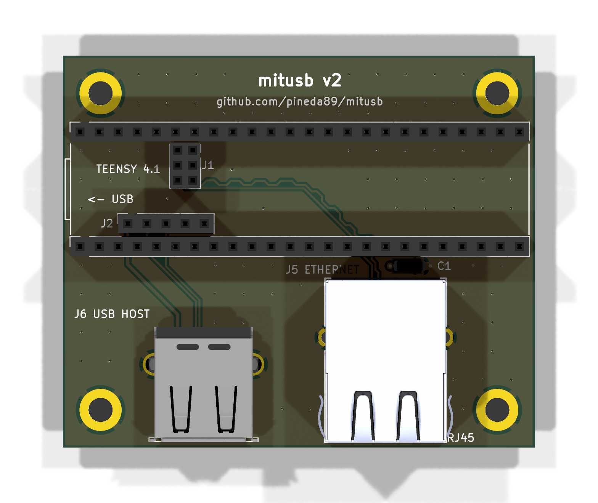

# hardware

Carrier PCB for the Teensy 4.1, designed in KiCad 9.

## Contents

| Path | What |
|---|---|
| `mitusb.kicad_pro` | KiCad project (schematic + PCB) |
| `library/` | Project-local symbols, footprints and 3D models |
| `production/Gerber.zip` | Gerbers and drill files |
| `production/BOM.csv` | Bill of materials with LCSC part numbers |
| `production/mitusb-all-pos.csv` | Pick-and-place positions |
| `renders/` | Renders of the bare PCB and with the Teensy fitted |
| `enclosure/mitusb-case.scad` | Parametric OpenSCAD enclosure: base and flat lid, four M3 screws |
| `enclosure/mitusb-base.stl`, `enclosure/mitusb-lid.stl` | Printable exports of the enclosure |
| `enclosure/renders/` | Renders of the enclosure |

## Parts

| Ref | Part |
|---|---|
| U1 | Teensy 4.1, socketed on two 1x24 2.54 mm headers (J3, J4) |
| J6 | USB-A receptacle (USB host port, for the mouse/keyboard) |
| J5 | HanRun HY931147C RJ45 with magnetics (Teensy Ethernet) |
| J1 | 2x03 2.00 mm socket (Teensy Ethernet header) |
| J2 | 1x05 2.54 mm socket (Teensy USB host header) |
| C1 | 100 nF |
| H1-H4 | M3 mounting holes |

Mount the Teensy with its micro-USB end towards the `<- USB` mark on the
silkscreen.

## Ordering

The production files are in JLCPCB format: upload `Gerber.zip`, then `BOM.csv`
and `mitusb-all-pos.csv` for assembly.

## Third-party libraries

The Teensy 4.1 (SparkFun DEV-16771) and HY931147C symbols, footprints and STEP
models in `library/` come from [SnapEDA](https://www.snapeda.com) and are
subject to [SnapEDA's terms](https://www.snapeda.com/about/terms/).
